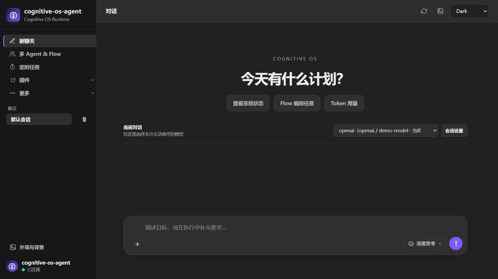
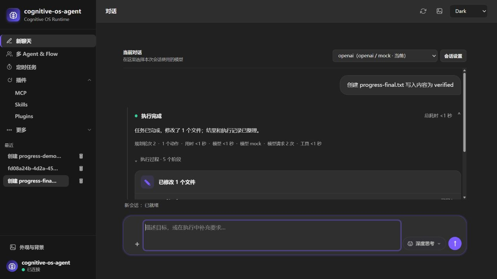
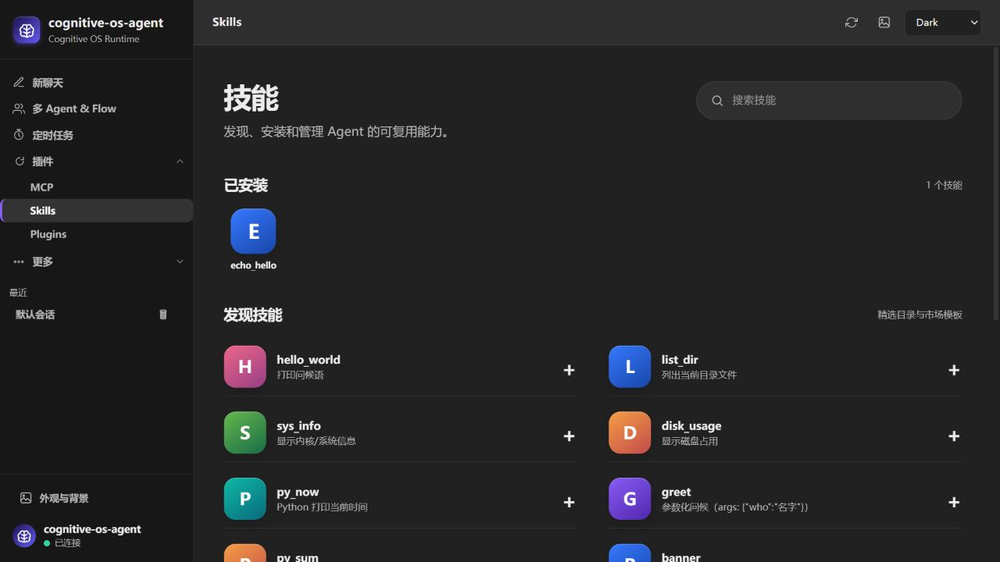
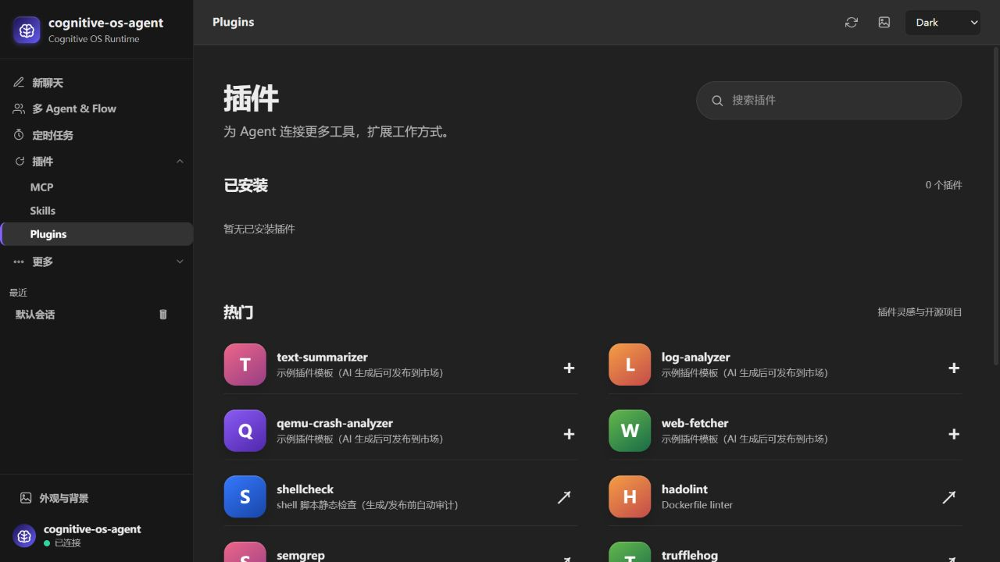
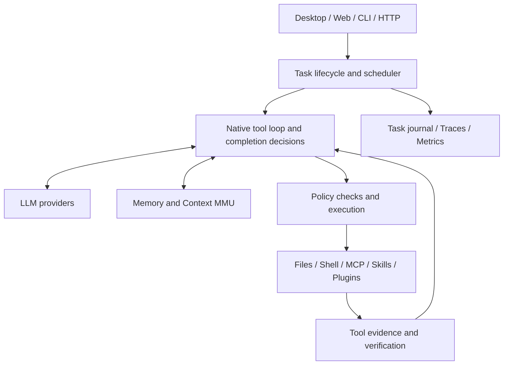

<div align="center">

# Cognitive OS

### Give AI agents a runtime, not just a conversation.

Run tools, coordinate agents, and inspect what happened — from a C11 core with an embedded web console.

[](https://github.com/LeonQin-ai/cognitive-os-agent/actions/workflows/ci.yml)
[](https://github.com/LeonQin-ai/cognitive-os-agent/releases/latest)
[](#architecture)
[](#quick-start)
[](LICENSE)

**[Download](https://github.com/LeonQin-ai/cognitive-os-agent/releases/latest) · [Quick start](#quick-start) · [Developer guide](backend/README.md) · [中文](README.zh-CN.md)**

</div>



**Cognitive OS is a local-first, model-agnostic agent runtime.** Use it as a desktop assistant, a CLI, or an HTTP service. Connect a model, give it tools, and follow tasks through model requests, commands, file changes, and final results.

The core is written in C11 and embeds its web console. Prebuilt packages do not require a Node.js or Python application stack; extensions such as browser automation and Python skills bring their own runtimes.

## What can you build with it?

| Use case | Workflow |
|---|---|
| **Understand a codebase** | Search and read source, run commands, and produce explanations grounded in tool results. |
| **Create documents and visual reports** | Combine reasoning with installed document, Python, or shell tools; inspect the resulting files. |
| **Coordinate specialist agents** | Chain review → implementation → testing in a Flow DAG, or let role-based agents discuss a topic. |
| **Automate recurring work** | Schedule jobs and inspect their recorded outcomes in the console. |
| **Embed an agent in your application** | Submit tasks over HTTP and read their status, tool steps, output, and metrics. |

Document generation, browser access, and multimodal tasks depend on the selected model and installed tools.

**[First-task guide](GETTING_STARTED.md) · [Contributing](CONTRIBUTING.md) · [Share the project](SHARE.md)**

## Quick start

### 1. Install or build

Download a Windows installer, Linux portable archive, or macOS package from **[Releases](https://github.com/LeonQin-ai/cognitive-os-agent/releases/latest)**. Open the desktop app, or run the server in the extracted Linux package:

```bash
./cognitive-os-agent serve 18300
```

To build from source:

```bash
git clone https://github.com/LeonQin-ai/cognitive-os-agent.git
cd cognitive-os-agent/backend
```

| Platform | Build command | Prerequisites |
|---|---|---|
| Linux | `make` | C compiler and Make |
| macOS | `make` | Xcode Command Line Tools |
| Windows / Git Bash | `bash build.sh cli` | Git Bash; script locates or bootstraps pinned Zig |
| Windows / PowerShell | `.\build.ps1 -Target cli` | PowerShell; script locates or bootstraps pinned Zig |

From `backend`, run `./build/cognitive-os-agent serve 18300` (Windows: `./build/cognitive-os-agent.exe serve 18300`).

### 2. Connect a model

Open **http://localhost:18300/** and configure a route on the **Models** page: provider, base URL, model, and API key. OpenAI-compatible endpoints, Anthropic, and local model services are supported. Use the mock provider for offline development.

The desktop app also uses port `18300`; close it before starting another server on that port. Keep API keys in local configuration, outside version control.

### 3. Start with a task you can verify

Try: **“Read this repository and write a source overview to overview.md. Cite the files you inspected.”** Follow the tool trace, then open the result.

Choose execution and state directories explicitly for CLI deployments:

```bash
./build/cognitive-os-agent --workspace /path/to/project --state /path/to/state serve 18300
```

**Workspace support:** The main branch includes saved workspace folders, per-chat workspace selection, and task-local execution directories. These changes are now integrated into `main`. Workspace selection chooses the execution root; it is not a security sandbox.

## See the work as it happens
**Terminal client:** run `cognitive-os-agent chat` to connect to the
desktop/server Runtime, continue durable conversations, inspect tool execution,
and cancel with Ctrl+C. Interactive terminals use a full-screen layout; native
OpenAI-compatible answers arrive incrementally as provisional previews.
Use `chat -p "your task"` for scripts. See the
[terminal client guide](backend/README.md#terminal-client).


Persistent conversations, image attachments, model selection, task steering, and execution history share one console. Tool details expose commands, results, status, and duration so you can investigate the run.



Flow DAGs express task dependencies. Group discussions let registered roles respond to other members across configurable rounds. Skills, MCP connections, and plugins extend available tools.

<details>
<summary>Explore Skills and Plugins</summary>





</details>

Screenshots use a local demonstration configuration and mock execution; they do not establish real-model task quality.

## Architecture



| Runtime service | What it provides |
|---|---|
| **Task lifecycle** | Scheduling, cancellation, durable state, and explicit recovery. |
| **Native tool loop** | Structured `tool_calls` / `tool_use` and completion declarations rather than answer-keyword matching. |
| **Memory and context** | Memory lifecycle services and budgeted hot/warm/cold context tiers. |
| **Execution and policy** | Action checks, file snapshots, verification, and rollback for supported operations. |
| **Coordination** | Role registration, dependency-based Flows, and group discussions. |
| **Observability** | Model/tool milestones, token accounting where available, task records, and metrics. |

File rollback does not undo arbitrary network or shell side effects. Workspace selection is not process isolation; recovery does not guarantee exactly-once execution. Distributed scheduling and enterprise multi-tenancy remain roadmap work. See the [implementation status](backend/docs/COGNITIVE_OS_DETAILED_DESIGN_V3.1.md).

## Evidence, not just feature claims

These are **historical project-reported runs**, not a fresh evaluation of every release. Models, tools, sample size, and run variance affect results.

| Evaluation | Recorded result | Scope |
|---|---|---|
| GAIA 2023 validation | **78.79%** | 165 tasks; GLM-5.3-flash; 2026-09-11 |
| SWE-bench Verified mini | **8/11** | 11-task sample; GLM-5.3-flash; 2026-09-12 |
| BFCL-style function calling | **20–22/22** | Project-built cases; deepseek-chat |
| WebArena-style browser tasks | **6/6** | Small project-built suite; GLM-5.3-flash |

The SWE-bench report also records a Docker-isolated rerun at **5/11**. Mini and “style” suites are not full official benchmark results. Read the [scorecard](backend/docs/BENCHMARK_RESULTS.md) and [methodology](backend/docs/benchmark-report.md) before comparing systems.

On the documented Windows machine, a deterministic workload completed **1,000,000 tasks in 65.972 seconds**, with 100 registered roles, 8 workers, and **78.65 MiB sampled peak RSS** (three-run median duration). This measures scheduling and context probes, **not one million LLM requests**. Registered roles are not concurrent processes.


[Setup and limits](backend/docs/runtime-benchmark-expanded.md) · [Raw million-task data](backend/docs/runtime-million-2026-10-14.json) · [Memory and queue samples](backend/docs/runtime-memory-2026-10-14.svg)

Real-model regressions, including failures and API costs, remain in the [historical report](https://github.com/LeonQin-ai/cognitive-os-agent/blob/v1.0.0/backend/docs/token-regression-report.md). They are targeted checks, not universal completion or token-efficiency guarantees.

## Build on the HTTP API

```bash
# Submit a task; the response contains its ID.
curl -X POST http://localhost:18300/v1/chat \
  -H 'Content-Type: application/json' \
  -d '{"message":"Create note.txt containing hello"}'

# Replace 0 with the returned task ID.
curl http://localhost:18300/v1/tasks/0
curl http://localhost:18300/v1/tasks/journal
curl http://localhost:18300/metrics
```

Authentication, model configuration, local Skills, MCP, and API details: **[developer guide](backend/README.md)**.

## Test and contribute

CI covers Windows, Linux, Linux AddressSanitizer, macOS Apple Silicon, and macOS Intel. Check the [workflow](https://github.com/LeonQin-ai/cognitive-os-agent/actions/workflows/ci.yml) for a commit’s actual status.

```bash
cd backend
COA_TOOL_PROTOCOL=legacy make test
COA_TOOL_PROTOCOL=legacy make scenario
```

On Windows, run `bash build.sh test`, then `./build/cognitive-os-agent-test.exe`. Offline fixtures validate runtime behavior without paid model calls. Live-model evaluations require credentials; browser tests need Playwright. Exact commands and environment settings are in [CI](.github/workflows/ci.yml) and the [developer guide](backend/README.md).

We welcome **reproducible task failures, provider compatibility fixes, tool recovery, context efficiency, UI accessibility, and documentation**. Include version/commit, OS, model/provider, expected behavior, and a redacted trace in bug reports. Never attach API keys or unauthorized private source.

**[Report a bug](https://github.com/LeonQin-ai/cognitive-os-agent/issues/new) · [Find an issue to work on](https://github.com/LeonQin-ai/cognitive-os-agent/issues)**

## Go deeper

| Resource | Contents |
|---|---|
| [Developer guide](backend/README.md) | Build, configuration, APIs, extensions, and local models |
| [Architecture baseline](backend/docs/COGNITIVE_OS_ARCHITECTURE_BASELINE_V3.0.md) | Component boundaries and design direction |
| [Detailed design](backend/docs/COGNITIVE_OS_DETAILED_DESIGN_V3.1.md) | Implementation status and remaining work |
| [Runtime whitepaper](backend/docs/runtime-whitepaper.md) | Scheduling, memory, execution, and diagrams |
| [Secret-security design](backend/docs/COGNITIVE_OS_SECRET_SECURITY_DDD_V1.0.md) | Security model and acceptance criteria |
| [Technical blog](https://leonqin-ai.github.io/) | Eight Chinese engineering articles linked to source and evidence |
| [Five-minute console recording](backend/docs/runtime-demo.mp4) | Real runtime/tool execution with a deterministic local model fixture |

## License

**[Apache License 2.0](LICENSE)**. Attribution and retained notices: [NOTICE](NOTICE). Third-party components keep their licenses. Earlier MIT-licensed releases remain available under their original terms.
