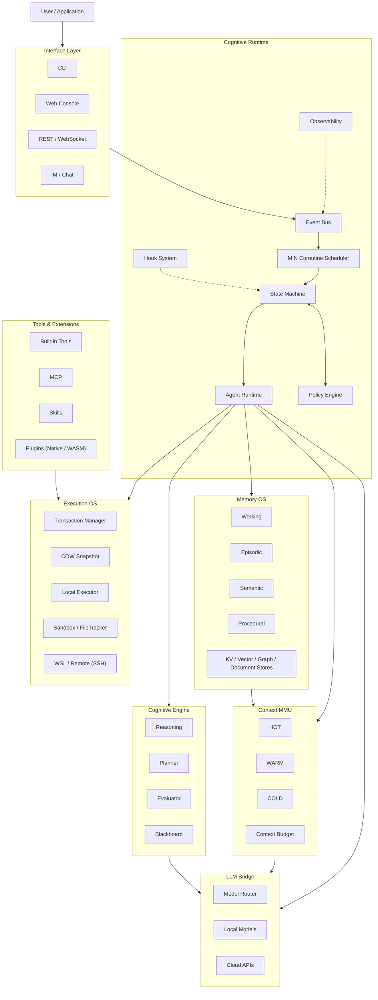

<div align="center">

# Cognitive OS

**A C-native runtime for autonomous AI agents — LLM is the accelerator, not the OS.**

[](https://en.wikipedia.org/wiki/C11_(C_standard_revision))
[](#quick-start)
[](#project-structure)
[](https://github.com/LeonQin-ai/cognitive-os-agent/actions/workflows/ci.yml)
[](LICENSE)

**[中文文档](README.zh-CN.md)**

</div>

---

Cognitive OS is a lightweight, model-agnostic **Agent Runtime / Cognitive Operating System** written in pure C11.

Most agent systems are a prompt loop:

```
User → Prompt → LLM → Tool → LLM → Tool → ...
```

Cognitive OS treats an agent as a **runtime-managed process**:

```
User / Application
        │
        ▼
┌─────────────────────┐
│    Cognitive OS     │
│    Agent Runtime    │
└──────────┬──────────┘
           │
   ┌───────┼────────┐
   ▼       ▼        ▼
 Memory  Context  Execution
  OS       MMU       OS
   │       │        │
   └───────┼────────┘
           ▼
      LLM / Tools
```

The runtime owns **state, scheduling, memory, context, execution, security, isolation and observability**. The LLM is invoked only when generalization, reasoning or semantic understanding is required.

## Why Cognitive OS?

An autonomous agent eventually becomes a **systems problem**. It needs lifecycle management, asynchronous execution, scheduling, memory management, context management, process isolation, tool permissions, transactional side effects, rollback, multi-agent coordination, observability, resource management, sandboxing and remote execution.

Cognitive OS moves these responsibilities **out of the prompt and into the runtime**.

| | Traditional agent framework | Cognitive OS |
|---|---|---|
| Control flow | LLM decides everything, every step | **State machine + rule engine drive; LLM fills the gaps** |
| Memory | Chat log in a context window | **Memory OS with a real lifecycle: encode → consolidate → reinforce → decay → archive** |
| Context | Stuff everything into the prompt | **Context MMU: hot/warm/cold tiers with budget, promotion and eviction** |
| Safety | Prompt-level "please don't" | **Policy engine hard-intercepts actions before they happen** |
| Side effects | Fire and forget | **Transactional: snapshot → execute → verify → commit / rollback** |
| Concurrency | Sequential tool loop | **M:N coroutine scheduler, parallel DAG layers** |
| Binary | node_modules + runtime | **A single static C binary with an embedded web console** |

The goal is not another prompt framework — it is the **runtime substrate underneath autonomous agents**.

## Benchmarks

The agent-quality results below use full-agent-loop tasks. Clean scorecard: [`backend/docs/BENCHMARK_RESULTS.md`](backend/docs/BENCHMARK_RESULTS.md) · methodology & failure attribution: [`backend/docs/benchmark-report.md`](backend/docs/benchmark-report.md).

Token/completion regression: a real-model targeted case now finishes naturally in **5 requests / 14,534 input tokens** (previously 8 / 24,463 and failed). Long-task artifacts were independently verified after a recovery fix; interrupted/failed attempts and all API costs are included in the [regression report](backend/docs/token-regression-report.md). This is not a universal token-savings claim.

| Benchmark | Score | Model |
|---|---|---|
| GAIA 2023 validation (official 165 tasks) | **78.79%** (L1 84.91 / L2 81.40 / L3 57.69) | GLM-5.3-flash |
| SWE-bench_Verified mini (11 tasks, official resolved standard) | **8/11 = 72.7%** | GLM-5.3-flash |
| BFCL-style function calling (22 cases, AST-strict) | **~94%** (20–22/22) | deepseek-chat |
| GAIA-style mini (17 tasks) | **17/17 = 100%** + vision 1/1 | GLM-5.3-flash |
| WebArena-style browser tasks (6 tasks) | **6/6 = 100%** | GLM-5.3-flash |
| Policy compliance (violating requests) | **bare LLM 0/4 → runtime policy engine 4/4** | deepseek-chat |

Notable: the same runtime reaches **78.79% on GAIA** and **72.7% on SWE-bench mini** with a mid-tier GLM-5.3-flash — and policy compliance goes **0/4 → 4/4** when rules move from the prompt into the runtime policy engine. The LLM is the accelerator; the runtime provides the guarantees.

### Runtime measurements — 2026-10-14

Measured on Windows 11 (build 26200), Intel Family 6 Model 142, about 8 GiB RAM,
Zig cc 0.14.1 `-O1`. These are actual Scheduler/AgentPool/MMU/file-recovery runs
with deterministic local workloads; they exclude production model inference.
Registered roles are not concurrent processes. The scale workload uses 8 workers,
64 context probes per task and 8 MiB aggregate context; 8 auxiliary Runtime workers
remain idle. Scale values are medians of 3 runs; peak RSS is the maximum of those runs.

| Registered roles | Completed tasks | Elapsed ms | Tasks/s | Queue P50 / P95 / P99 ms | Peak RSS MiB |
| --- | --- | --- | --- | --- | --- |
| 100 | 10,000 | 579.370 | 17,260 | 0.114 / 0.254 / 0.364 | 16.95 |
| 1,000 | 10,000 | 578.199 | 17,295 | 0.114 / 0.258 / 0.392 | 17.09 |
| 100 | 100,000 | 5748.495 | 17,396 | 0.113 / 0.262 / 0.422 | 22.48 |
| 1,000 | 100,000 | 5771.132 | 17,328 | 0.113 / 0.257 / 0.376 | 22.57 |
| 100 | 1,000,000 | 65971.943 | 15,158 | 0.131 / 0.313 / 2.039 | 78.65 |
| 1,000 | 1,000,000 | 72279.054 | 13,835 | 0.144 / 0.346 / 14.790 | 77.92 |

All submitted tasks were admitted and completed, with zero failures/rejections;
ending active/queued counts were zero. Completed history was bounded to 64 records.
RSS samples include the retained benchmark verification arrays, not just task history.

The million-task extension ran 6,000,000 tasks in total (100/1000 roles, three runs each). Duration ranges were 58.743–74.076 s and 71.629–73.305 s respectively. At 1000 roles, throughput was about 20% lower than the retained 100,000-task baseline and P99 queue latency increased to 14.790 ms; sampled queue bursts reached 6201 tasks. These measurements do not establish linear scaling or a latency SLO. [Independent million-task JSON](backend/docs/runtime-million-2026-10-14.json) retains every run and its memory/queue samples.


A separate **backlog gate** held workers until 100,000 tasks had been submitted:
**99,992 queued**, 39.942 s until drained,
59.07 MiB peak RSS. Its queue delay includes the intentional
hold and is reported separately from ordinary throughput runs.

**Context pressure — one run per layout.** Three canonical records were made HOT,
evicted, reduced to WARM overviews, rehydrated to HOT, then reloaded from disk with
all original lengths and content hashes verified. L1 overviews are lossy; the
canonical store keeps complete content. RSS includes source records and serialization,
so MMU context budget is not a process-RAM limit. Source texts are generated ASCII
fixtures, not production conversation transcripts. No GiB prompt was sent to a model.

| Context layout MiB | Peak RSS MiB | Eviction recall ms | WARM cache bytes | HOT rehydrate ms | Canonical reload ms | Content checks |
| --- | --- | --- | --- | --- | --- | --- |
| 512 / 128 / 10 | 2860.61 | 306.725 | 3,900 | 7330.594 | 1144.853 | Passed |
| 768 / 128 / 128 | 3197.01 | 887.189 | 3,900 | 15020.763 | 2014.049 | Passed |

Per-operation counts and P50/P95/P99 are retained in JSON (bounded last-64 sample
windows; the large cases contain only 3 evictions each). These small samples do
not establish a tail-latency SLO.

**Crash recovery — one real process-termination run:** RUNNING task + available
snapshot → forced Runtime exit → INTERRUPTED detection → verified snapshot restore
→ explicit replay → DONE → successful subsequent task. Restart detection:
**511.031 ms**; snapshot restore: **18.285 ms**;
explicit replay to DONE: **54.946 ms**; crash to DONE:
**591.759 ms**. The killed boundary is the entire Runtime process
(`TerminateProcess` here, `SIGKILL` in POSIX tests), not an isolated in-process worker.
Replay covers idempotent file replacement; arbitrary external operations are not
replayed automatically and exactly-once/power-loss recovery are not claimed.

[Full benchmark report](backend/docs/runtime-benchmark-expanded.md) ·
[Whitepaper and 3 architecture diagrams](backend/docs/runtime-whitepaper.md) ·
[5-minute continuous live console recording](backend/docs/runtime-demo.mp4).

[](backend/docs/runtime-demo.mp4)

Original-speed application recording with Chinese captions (silent): real tool/file
execution, paginated source reading, two-agent group replies, 100,000-task Runtime
load, Context recovery and regression commands. The model is a **local deterministic
fixture**, while the Runtime and tools execute normally. [Recording evidence](backend/docs/runtime-demo-evidence.json).

Reproduce after building `runtime-bench` / `bench-runtime`:

```bash
cd backend
python tests/run_runtime_measurements.py --full --output docs
python tests/run_runtime_measurements.py --million --compiler "actual compiler/version/flags" --output docs
python tests/test_runtime_benchmark.py          # scale + MMU + backlog correctness smoke
python tests/test_crash_recovery_e2e.py --report # owned process kill, restore, explicit replay
```

Raw measurements: [scale](backend/docs/runtime-scale-2026-10-14.json),
[backlog](backend/docs/runtime-backlog-2026-10-14.json),
[Context](backend/docs/runtime-context-pressure-2026-10-14.json),
[crash recovery](backend/docs/runtime-crash-recovery-2026-10-14.json).
The previous [128 MiB baseline](backend/docs/runtime-benchmark.md) used a different
per-task memory probe scheme and is retained as history, not a direct scaling comparator.

## Technical blog series

[Eight Chinese engineering articles](https://leonqin-ai.github.io/) walk through the
C11 Runtime, reciprocal Agent discussions, Flow dependencies, Memory/Context,
tool protocols, recovery, million-task measurements, and reproducible demos.
Each article links to source and verification evidence, with measurement limits
kept explicit.

The blog is maintained in its [independent GitHub Pages repository](https://github.com/LeonQin-ai/LeonQin-ai.github.io).

## Web Console

The embedded console supports persistent chat sessions, observable agent runs,
task steering, multi-agent flows, scheduled jobs, and local Skills/MCP/plugins.
Screenshots below use a local demo configuration and mock execution.

Agent groups support reciprocal discussions: register role-based agents, select
members, and send a topic. Each role sees the others' latest contributions across
3 rounds by default (configurable from 1 to 5). The left-side status shows the
speaker and round, with a stop control. A new human message takes over the older
discussion; unanimous completion can end it early. See the [group API](backend/README.md#im-bridge-and-agent-groups).


Execution history shows model and tool milestones, touched files, timing, and
expandable action details. The Skills and Plugins pages provide searchable
discovery and installed-item management.


<details>
<summary>Skills and Plugins screens</summary>


</details>

## Architecture



## The Cognitive Loop

An agent is not a chat completion. Cognitive OS models an agent as a **stateful control loop driven by the runtime**:

```
RECEIVE → UNDERSTAND → RECALL → REASON → PLAN → POLICY CHECK
      → SNAPSHOT → ACT → VERIFY → COMMIT / ROLLBACK → LEARN
                                                      │
                                      └──→ next cycle
```

A deterministic state machine handles lifecycle, retries, timeouts, scheduling, policy enforcement, tool dispatch, transaction boundaries and failure handling. The LLM is used for semantic understanding, planning, reasoning, decomposition and generalization — the parts that actually need a model.

This makes the system far less dependent on the model's ability to hold the entire control flow inside a context window.

## Cognitive Runtime

The kernel-like core: agent lifecycle, state machine, event bus, **M:N coroutine scheduler** (ucontext on Linux, fibers on Windows), agent pool, policy engine, hook system, capability system and observability.

Agent workloads are naturally asynchronous. The coroutine scheduler runs many cheap agent tasks over a small thread pool instead of coupling every operation to an OS thread — a foundation for asynchronous I/O, distributed scheduling, agent isolation and resource quotas.

## Memory OS

Memory is not a vector database. It is a **lifecycle-managed subsystem**:

```
ENCODE → STORE → RECALL → CONSOLIDATE → REINFORCE → DECAY → ARCHIVE
```

| Type | Purpose |
|---|---|
| Working | Current task state and short-term reasoning |
| Episodic | Previous agent experiences |
| Semantic | Facts, knowledge and learned concepts |
| Procedural | Skills, workflows and successful action sequences |

Storage is abstracted behind a **Memory Service interface (vtable)** — KV, vector, graph and document stores are swappable; the runtime never depends on a specific database.

## Context MMU

A context window is treated as **managed memory**, not an infinitely expandable prompt:

| Tier | Content |
|---|---|
| **HOT** | Current goal, plan, active tool call, latest results, errors |
| **WARM** | Recent observations, related memories, previous tool results, code fragments |
| **COLD** | Historical tasks, documentation, large repositories, archived knowledge |

The Context MMU decides what to load, what to keep out, what to promote, what to evict, and how much budget remains — so the agent can operate over large knowledge bases without stuffing everything into the prompt.

RAG is part of this pipeline (not a bolted-on chatbot feature): chunk → embed → **hybrid retrieval** (vector + keyword) → **rerank** → context builder → Context MMU → LLM, with optional **HyDE** for cold-tier queries.

## Transactional Execution

Agents modify the real world, so execution needs **transaction semantics**:

```
BEGIN → SNAPSHOT → EXECUTE → VERIFY
                        ├── success → COMMIT
                        └── failure → ROLLBACK (file-level undo)
```

- Copy-on-write snapshot engine (runtime-native — git may *inform* it, but git is not the transaction mechanism)
- 64 MB per-file capture guard (configurable), git-workspace aware
- Works for arbitrary files, temporary workspaces, generated code, build artifacts, sandbox and remote execution

## Execution OS

Execution is abstracted behind an executor interface: `execute(command, capability, policy, environment)` — the runtime picks the backend.

```
Executor ── Local ── Linux / Windows
         ├─ Sandbox ── WASM (wasm3) + FileTracker
         ├─ WSL
         └─ Remote ── SSH
```

FileTracker snapshots the filesystem before execution, diffs it after, and reports every read/write/delete/exec as structured evidence.

## Security & Policy

Security must not live in the prompt:

```
Agent Plan → Policy Engine → Hook System → Capability Check → Executor → Audit
```

Policy decisions are **ALLOW / DENY / ASK** with risk scoring, over tool, command, path, network, plugin, agent and execution environment. Rules **hard-intercept** before any side effect — the LLM cannot talk its way past them.

Hooks provide a second horizontal interception layer (`agent.before_run`, `exec.before_execute`, `llm.before_request`, `memory.before_write`, …) and can observe, modify or **veto** an operation.

## Multi-Agent Runtime

Agents behave like **isolated runtime instances** — each with its own memory, context, tools and policy — not multiple prompts sharing one global chat log:

```
Supervisor → Task compiled into a Flow DAG
   ├── Analyze   (layer 0)
   ├── Search    (layer 0)     ← independent nodes run in parallel
   └── Inspect   (layer 0)
        └── Merge → Execute → Verify   (dependent layers)
```

The Flow compiler validates the DAG (Kahn's algorithm: cycle detection + layering), executes each layer in parallel, and supports `{{node-id}}` references so downstream nodes consume upstream results.

## LLM Bridge

Deliberately model-agnostic. One unified interface speaks **OpenAI-compatible and Anthropic** protocols (both with SSE streaming) — DeepSeek, Claude, GPT, Qwen, **Ollama / llama.cpp** (one-click start from the console) or an offline mock. A model router balances by round-robin, cost, latency or capability tags. The same runtime runs offline, on a local GPU, against a cloud API, or on a remote inference cluster.

## Tools & Extension System

A unified capability model: built-in tools (file / shell / git / glob / grep), **MCP** (stdio + HTTP), skills marketplace, generated tools (successful tool sequences are **distilled into reusable skills** — a self-improvement loop), native C plugins and **WASM plugins** (wasm3 sandbox + capability tokens). The AI plugin generator runs analyze → architect → codegen → **security audit** → test → register; the runtime still decides whether the generated capability may execute.

## Observability

Everything important is observable: every stage of the cognitive loop publishes events on the bus; JSONL audit trail; Prometheus-style metrics; WebSocket push to the console. An agent run can be fully reconstructed — essential for debugging autonomous systems.

## A Typical Agent Run

> "Find the kernel regression and fix it."

```
1. Understand the request
2. Recall previous debugging experience      (episodic memory)
3. Retrieve relevant source / documentation  (RAG)
4. Ask the LLM for reasoning, generate plan  (planner)
5. Policy check                              (policy engine)
6. Create snapshot                           (COW snapshot)
7. Inspect → Modify → Build → Run regression test
8. Verify  ── PASS ──→ COMMIT
           └─ FAIL ──→ ROLLBACK → re-plan → retry
9. Learn: experience → episodic memory
          → consolidation → semantic / procedural memory
```

The system does not simply answer — it **executes, verifies and learns**.

## Design Principles

1. **LLM is the accelerator, not the OS.** The runtime owns deterministic control flow.
2. **Context is a managed resource** — allocation, budget, promotion, eviction, persistence.
3. **Memory has a lifecycle** — not just an embedding dump in a vector store.
4. **Side effects are transactional** — execute → verify → commit, or rollback.
5. **Security is enforced by the runtime** — policy, capability, hook, sandbox, audit. Not "please don't run `rm -rf`".
6. **Core abstractions are replaceable** — storage, LLM providers, executors and plugins connect through stable interfaces.
7. **Everything important is observable.**
8. **C is the runtime substrate.** The model provides cognition; the runtime provides execution.

## Project Structure

```
cognitive-os-agent/
├── backend/
│   ├── include/cognitive-os-agent/   public headers — one per module, by layer
│   ├── src/
│   │   ├── runtime/         event bus · M:N scheduler · state machine · policy · hooks
│   │   │                    flow compiler (DAG) · orchestrator · state store · agent pool
│   │   ├── cognition/       reasoning (bounded agent loop) · planner · evaluator · blackboard
│   │   ├── memory/          Memory OS facade · KV/vector/graph/episode stores · service vtable
│   │   ├── retrieval/       knowledge index · embeddings · rerank · context builder (MMU)
│   │   ├── llm/             openai · anthropic adapters · SSE · router · capabilities
│   │   ├── action/          tools (file/shell/git/mcp/skill/glob/grep) · MCP connections
│   │   ├── execution/       executor vtable: local · WSL · remote routing
│   │   ├── tx/ + snapshot/  transactions + COW snapshot engine
│   │   ├── plugin_runtime/  dynamic loader · wasm3 sandbox · capability tokens · filetracker
│   │   ├── plugin_intelligence/  analyzer · architect · codegen · security audit
│   │   ├── api/             HTTP/1.1 server · REST · WebSocket (RFC6455) · auth
│   │   ├── im/              IM channels · Telegram bridge
│   │   ├── os/              threads · coroutines · sockets · processes · fs
│   │   └── infra/           logging · config · metrics · audit · lock-free MPMC ring buffer
│   ├── apps/web/            embedded web console (compiled into the binary)
│   ├── cli/                 interactive CLI
│   ├── tools/               mock-llm-server · desktop shell (WebView2) · installer assets
│   ├── tests/               unit · scenario · e2e · adapters · BFCL-style benchmark
│   ├── docs/                architecture v3.0 · detailed design v3.1 · security design · benchmarks
│   └── third_party/         cJSON (MIT) · wasm3 (MIT) · webview (MIT)
├── LICENSE
└── README.md
```

The architecture is intentionally layered — each layer exposes stable interfaces instead of leaking implementation details upward:

```
Application → Agent Runtime → Cognitive/Memory/Execution Services → OS Abstraction → Operating System
```

## Quick Start

```bash
git clone https://github.com/LeonQin-ai/cognitive-os-agent.git
cd cognitive-os-agent/backend

# Linux
make

# macOS (Apple Silicon or Intel; Xcode command-line tools required)
make
bash package-macos.sh       # native .app + architecture-specific ZIP

# Windows — bundled Zig toolchain, no system compiler needed
.\build.ps1 all             # PowerShell
# or: build.bat / ./build.sh

# Run the interactive CLI
./build/cognitive-os-agent

# Start the web console
./build/cognitive-os-agent serve 18300
# → http://localhost:18300/
```

The embedded web console ships a ChatGPT-style dark UI: multi-session chat with
**per-session history that survives restarts** (persisted as JSONL under the
state root), structured live stages and tool steps, elapsed time and token usage.
You can send another message while a task is running; the runtime accepts it as
steering, updates the plan at the next safe checkpoint, and continues with the
completed evidence intact. It also includes a model picker in the chat sidebar,
scheduled jobs (cron, interval or daily) with visible run results, and a
durable task journal with one-click **checkpoint resume** (`POST /v1/tasks/<id>/resume`).

Drive it over HTTP:

The Windows desktop app uses port `18300`. Run the standalone CLI server above
only when the desktop app is closed, since both use the same port.

```bash
curl -X POST http://localhost:18300/v1/chat -H 'Content-Type: application/json' -d '{"message":"Create note.txt with content hello"}'
curl http://localhost:18300/v1/tasks/0    # inspect a task; use the id returned above
curl http://localhost:18300/v1/tasks/journal   # durable task history (checkpoint)
curl http://localhost:18300/v1/cron       # scheduled jobs (interval / daily)
curl http://localhost:18300/v1/tools      # registered tools
curl http://localhost:18300/v1/memory     # Memory OS state
curl http://localhost:18300/metrics       # gauges: context.bytes_*, memory.*, tx.*
```

Point it at a real LLM (or run fully offline with the mock provider):

```json
{
  "llm.provider": "openai",
  "llm.base_url": "https://api.deepseek.com/v1",
  "llm.model": "deepseek-chat",
  "llm.api_key": "sk-..."
}
```

## Testing

Quality gate: CI builds and tests on Windows (zig cc), Linux (gcc and AddressSanitizer), macOS Apple Silicon, and macOS Intel.

```
unit:      3331 passed, 0 failed   (local Windows verification, 2026-10-16)
scenario:  91 checks, 0 failed     (HTTP server, plugins, MCP stdio, flows)
e2e:       E2E PASS                (real HTTP, both protocols)
adapters:  ADAPTER PASS            (chat + SSE stream, openai + anthropic)
bench:     BFCL-style 22 cases     (simple / multiple / parallel / irrelevance / policy)
ASAN:      0 memory errors
```

Latest issue verification (2026-10-14): [CI run 38510473915](https://github.com/LeonQin-ai/cognitive-os-agent/actions/runs/38510473915) passed all five platform jobs. The image-wait regression checks a real upload, the image payload and 8192-token budget, slow-provider failure without automatic retry/synthesis, a subsequent successful image request, and an unchanged 32768-token text-planning budget. It runs on Windows, Linux and both macOS architectures. Runtime smoke covers scale, MMU integrity and queue backlog; crash recovery uses actual process termination. The five browser regression checks cover left-side session status and latest interrupted-task history.

The image-wait regression also covers a permanently silent provider and a response body delivered one byte at a time. A fixed receive deadline prevents trickling data from extending the wait indefinitely; timed-out or incomplete bodies are discarded. With a 1000 ms test configuration, both cases reach FAILED within 5 seconds on Windows (allowing its per-stage timeout behavior), issue only one model call each, and leave subsequent image/text requests usable.

```bash
python backend/tests/test_vision_wait_e2e.py
```

Group discussion verification (2026-10-16, local Windows): **109 targeted native checks**, **3331 full-suite checks**, reciprocal three-round HTTP exchanges, one-round compatibility, unanimous/partial completion, Agent failure, cancellation, message takeover, settings/restart persistence, and browser controls at 390px all passed. The HTTP regressions use a local deterministic provider with real Runtime execution; they do not measure model discussion quality.

```bash
python backend/tests/test_im_discussion_e2e.py
python backend/tests/test_im_members_e2e.py
```

### Running the tests yourself

All suites are self-contained and need **no API key, no network, no external services** (the LLM is mocked). Every binary exits non-zero on failure.

**Linux / macOS:**

```bash
cd backend
make                # builds all test binaries (or: make test/scenario to build+run one)
make test           # unit tests; prints the current pass count
make scenario       # scenario checks     → "SCENARIO PASS"
./build/test-adapters            # adapter checks      → "ADAPTER PASS"
./build/cognitive-os-agent-bench --mock   # benchmark sanity (offline mock)
./build/mock-llm-server 9000 &    # e2e needs the mock LLM server running first
./build/cognitive-os-agent-e2e   #                      → "E2E PASS"
```

**Windows (MSYS2 / Git Bash, bundled Zig toolchain):**

```bash
cd backend
./build.sh                               # builds everything
./build/cognitive-os-agent-test.exe      # unit tests
./build/cognitive-os-agent-scenario.exe  # scenario checks
./build/test-adapters.exe                # adapter checks
./build/cognitive-os-agent-bench.exe --mock
./build/mock-llm-server.exe 9000 & ./build/cognitive-os-agent-e2e.exe
```

On macOS, `bash package-macos.sh` creates a native Cocoa/WebKit app in
`dist/Cognitive OS.app` and a ZIP for the current architecture. Set
`MACOS_SIGN_IDENTITY` for Developer ID signing; the default is an ad-hoc signature.

| Suite | Binary | What it verifies |
|---|---|---|
| unit | `cognitive-os-agent-test` | All 43 modules: state machine, event bus, scheduler, memory lifecycle, Context MMU, transactions, policy, hooks, flow, … |
| scenario | `cognitive-os-agent-scenario` | End-to-end scenarios: HTTP API, plugins, MCP stdio, flows, huge-file snapshot guards |
| adapters | `test-adapters` | LLM provider protocols: chat + SSE streaming (openai + anthropic, real HTTP) |
| e2e | `cognitive-os-agent-e2e` | Full agent runs against a mock LLM server (`mock-llm-server 9000`) |
| bench | `cognitive-os-agent-bench --mock` | BFCL-style benchmark harness sanity (offline) |

> The bench-real / bench-bfcl binaries also run offline with `--mock`. With `--real` they hit a real LLM via `COA_LLM_*` environment variables (provider / base_url / model / api_key) — use them only when you have an API key.

**CI** runs on every push and pull request across Windows, Linux, Linux AddressSanitizer, macOS Apple Silicon, and macOS Intel. See [`.github/workflows/ci.yml`](.github/workflows/ci.yml).

Benchmark scorecard: [`backend/docs/BENCHMARK_RESULTS.md`](backend/docs/BENCHMARK_RESULTS.md) · methodology and real-LLM results: [`backend/docs/benchmark-report.md`](backend/docs/benchmark-report.md).

## Documentation

The design documents describe target architecture; the detailed design's implementation-status section distinguishes shipped features from roadmap work.

| Doc | Content |
|---|---|
| [`backend/docs/BENCHMARK_RESULTS.md`](backend/docs/BENCHMARK_RESULTS.md) | Clean benchmark scorecard (GAIA / SWE-bench / BFCL / policy compliance) |
| [`backend/docs/COGNITIVE_OS_ARCHITECTURE_BASELINE_V3.0.md`](backend/docs/COGNITIVE_OS_ARCHITECTURE_BASELINE_V3.0.md) | Proposed architecture baseline and component boundaries |
| [`backend/docs/COGNITIVE_OS_DETAILED_DESIGN_V3.1.md`](backend/docs/COGNITIVE_OS_DETAILED_DESIGN_V3.1.md) | Detailed design, implementation status, and remaining gaps |
| [`backend/docs/COGNITIVE_OS_SECRET_SECURITY_DDD_V1.0.md`](backend/docs/COGNITIVE_OS_SECRET_SECURITY_DDD_V1.0.md) | Secret-security design and acceptance criteria |
| [`backend/docs/benchmark-report.md`](backend/docs/benchmark-report.md) | Agent benchmark methodology and real-LLM results (detailed record behind the scorecard) |
| [`backend/README.md`](backend/README.md) | Developer docs: build, concurrency model, API, configuration, marketplace, local models |

## Roadmap

The project evolves from a local agent runtime toward a distributed agent operating environment.

**Phase 1 — Cognitive Runtime** ✅
Agent lifecycle · event bus · M:N coroutine runtime · state machine · policy / hooks · agent orchestration

**Phase 2 — Cognitive Memory** ✅
Memory OS abstraction · working/episodic/semantic/procedural memory · retrieval · Context MMU
→ memory consolidation → reflection → long-term procedural learning

**Phase 3 — Execution OS** ✅
Local execution · transactions / snapshots · file tracking · WSL / remote (SSH) executors · WASM sandbox
→ OS-level sandbox (job objects / namespaces) → VM → containers

**Phase 4 — Multi-Agent Runtime** ✅
Flow DAG orchestration · parallel agent execution · per-agent isolation
→ resource quotas → capability isolation → agent-level scheduling

**Phase 5 — Distributed Agent Runtime** 🔜
Distributed scheduler · remote agent nodes · workload placement · node health management · centralized observability · node scheduling (control-plane split)

**Phase 6 — Enterprise Cognitive OS** 🔜
Multi-tenancy · RBAC / ABAC · centralized policy · distributed memory · enterprise model routing · audit

The same runtime supports two deployment modes: **personal** (local-first, single binary) and **enterprise** (a control plane managing a fleet of agent nodes — the enterprise layer manages the fleet rather than replacing the runtime).

## Why C?

Not because "C is faster" — because the runtime sits **close to the operating system**. C gives direct control over memory, threads, coroutines, scheduling, sockets, processes, filesystem, IPC, signals, resource ownership and ABI boundaries. An agent runtime increasingly resembles **OS + database + scheduler + sandbox + AI runtime**; the model itself does not need to be implemented in C, the runtime does.

## What Makes This Different?

### vs. Claude Code / Codex CLI / a DeepSeek harness

Claude Code and Codex are polished end-user agent products driven by frontier models; a DeepSeek harness (deepseek-chat + function calling) is a capable but bare prompt loop. Cognitive OS is not competing on product polish — it is the **runtime layer underneath**, and that changes where the guarantees live:

| | Claude Code | Codex CLI | DeepSeek harness | **Cognitive OS** |
|---|---|---|---|---|
| What it is | agent CLI product | agent CLI product | model + tool-calling loop | **open agent runtime substrate** |
| Stack | Node / TypeScript | Rust | Python / API | **pure C11 · zero external deps · one static binary** |
| Control flow | model-driven loop | model-driven loop | model-driven loop | **runtime state machine + rule engine; LLM at decision points** |
| Safety | permission prompts / modes | sandbox + approvals | none built in | **policy engine hard-intercepts (ALLOW/DENY/ASK) + hooks + capabilities + audit trail — measured bare LLM 0/4 → runtime 4/4** |
| Side effects | best-effort, git checkpoints | sandboxed, no rollback | none | **transactional: snapshot → execute → verify → commit / rollback** |
| Memory | markdown notes | session state | chat log | **Memory OS lifecycle (working/episodic/semantic/procedural) + Context MMU hot/warm/cold tiers with budget & eviction** |
| Concurrency | sequential tool loop + subagents | sequential tool loop | sequential tool loop | **M:N coroutine scheduler, parallel DAG layers** |
| Multi-agent | subagent tool | — | — | **Flow DAG compiler, per-agent isolation (own memory / context / tools / policy)** |
| Extensions | MCP + plugins | MCP | function calling | **MCP + self-distilling skills (successful sequences become reusable) + native / WASM sandboxed plugins** |
| Model lock-in | Anthropic | OpenAI | DeepSeek | **any OpenAI-compatible / Anthropic / local (Ollama) / offline mock** |
| Verifiable offline | needs API access | needs API access | needs API access | **3331 unit + 91 scenario + e2e/adapter suites run keyless against the mock provider, ASAN-clean** |

The point of the comparison is not "better product" — it is that **policy enforcement, transactions, memory lifecycle, scheduling and isolation are runtime services here, not prompt conventions or product features**. That is what lets the same runtime score 78.79% on GAIA and enforce policy 4/4 with a mid-tier model.

### Architectural boundary

Cognitive OS is not competing with agent frameworks on prompt abstractions — its architectural boundary is different:

```
Agent Framework            Cognitive OS
───────────────            ─────────────────────────────────────
LLM                        ┌───────────────────────────────────┐
│                          │ Cognitive Runtime                 │
Prompt / Chain             │ state / scheduler / events        │
│                          │ policy / hooks / capability       │
Tools                      │ agent lifecycle / isolation       │
│                          └──────────────┬────────────────────┘
Memory                     Memory OS │ Context MMU │ Execution OS
                                          │ LLM Bridge
                                    local / cloud / GPU
```

The central idea: **an autonomous agent needs an operating environment, not just a prompt loop.**

## Project Status

An active research / engineering project, evolving:

```
Single-node Agent Runtime → Multi-Agent Runtime → Sandboxed Runtime
→ Remote Runtime → Distributed Runtime → Enterprise Agent Operating Platform
```

The current implementation establishes the runtime primitives first.

## Contributing

The codebase is deliberately small and layered — a new contributor can read one layer per sitting. Particularly interesting areas: scheduler / coroutine / event bus (runtime), planner / evaluator / reflection (cognition), memory service / retrieval / Context MMU (memory), sandbox / VM / remote executor / snapshot (execution), multi-agent / DAG / isolation (agent), observability / distributed control plane (infrastructure).

PRs welcome: pick a module, keep the C11 + zero-dependency discipline, keep the core architecture modular, preserve the runtime boundary, and make the test suite pass — see [Testing](#testing) for how to run it locally (no API key needed).

## License

[MIT](LICENSE) — vendored third-party code keeps its own MIT headers (cJSON, wasm3, webview).

---

<div align="center">

**Build the runtime underneath autonomous intelligence.**

*If you find this project interesting — a full cognitive OS in portable C — please give it a ⭐.*

</div>
