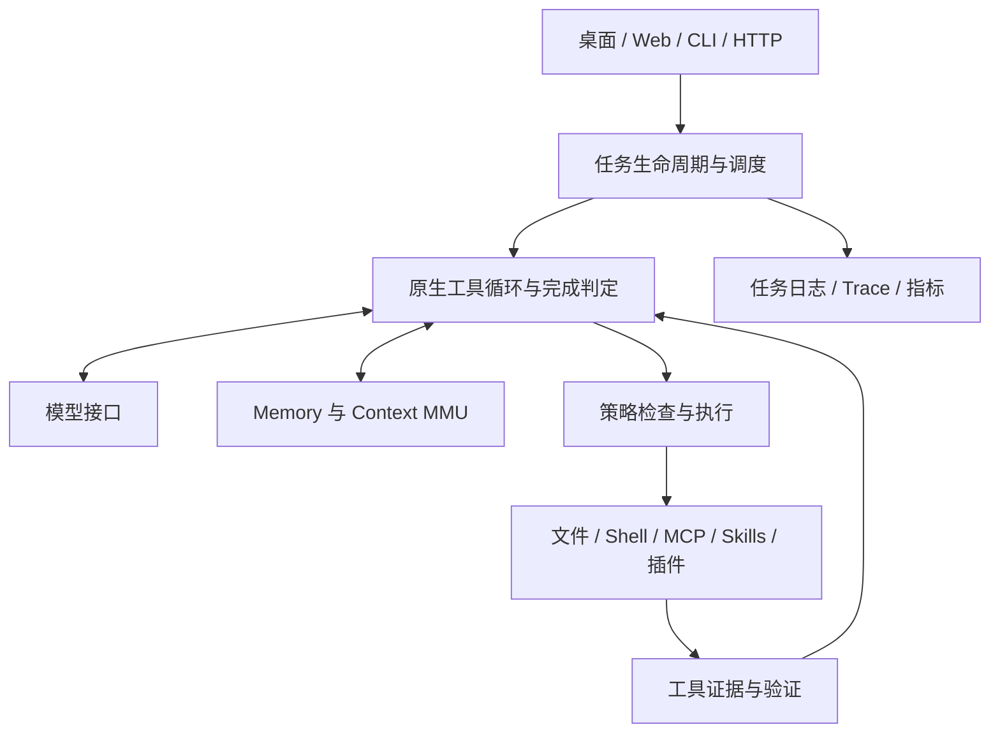

<div align="center">

# Cognitive OS · 认知操作系统

### 让 AI 从回答问题，走向执行任务。

用 C11 构建智能体运行时，把工具执行、多 Agent 协作与过程追踪放进一个本地应用。

[](https://github.com/LeonQin-ai/cognitive-os-agent/actions/workflows/ci.yml)
[](https://github.com/LeonQin-ai/cognitive-os-agent/releases/latest)
[](#架构与设计)
[](#快速开始)
[](LICENSE)

**[下载体验](https://github.com/LeonQin-ai/cognitive-os-agent/releases/latest) · [快速开始](#快速开始) · [开发文档](backend/README.md) · [English](README.md)**

</div>


**Cognitive OS 是一个本地优先、模型无关的智能体运行时。** 你可以把它作为桌面助手、命令行工具，或通过 HTTP 接入自己的应用。连接模型、赋予工具，再从记录中查看它调用了什么、修改了什么、最终交付了什么。

核心采用 C11，应用内嵌 Web 控制台。预编译版本无需先搭建 Node.js 或 Python 应用环境；浏览器自动化、Python 技能等扩展则需要各自的运行环境。

## 你可以用它做什么？

| 场景 | 工作方式 |
|---|---|
| **理解一个代码仓库** | 搜索源码、分段阅读、运行命令，输出有文件依据的分析。 |
| **制作文档与可视化报告** | 配合已安装的文档、Python 或 shell 工具生成文件，并检查实际产物。 |
| **组织多个专业 Agent** | 用 Flow DAG 串联审核、实现、测试，或让不同角色围绕同一话题相互讨论。 |
| **处理周期性工作** | 设置定时任务，在同一控制台查看执行结果。 |
| **为自己的应用加入 Agent** | 通过 HTTP 提交任务，读取状态、工具步骤、输出和指标。 |

文档生成、浏览器操作和多模态任务取决于所选模型及已安装工具。

**[首次任务指南](GETTING_STARTED.md) · [贡献指南](CONTRIBUTING.md) · [项目分享素材](SHARE.md)**

## 快速开始

### 1. 下载或构建

从 **[Releases](https://github.com/LeonQin-ai/cognitive-os-agent/releases/latest)** 下载 Windows 安装包、Linux 便携包或 macOS 应用包。打开桌面应用；Linux 便携包解压后可运行：

```bash
./cognitive-os-agent serve 18300
```

希望从源码构建？

```bash
git clone https://github.com/LeonQin-ai/cognitive-os-agent.git
cd cognitive-os-agent/backend
```

| 平台 | 构建命令 | 环境要求 |
|---|---|---|
| Linux | `make` | C 编译器和 Make |
| macOS | `make` | Xcode Command Line Tools |
| Windows / Git Bash | `bash build.sh cli` | Git Bash；脚本定位或引导安装固定版本 Zig |
| Windows / PowerShell | `.\build.ps1 -Target cli` | PowerShell；脚本定位或引导安装固定版本 Zig |

在 `backend` 目录执行 `./build/cognitive-os-agent serve 18300`；Windows 执行 `./build/cognitive-os-agent.exe serve 18300`。

### 2. 连接模型

打开 **http://localhost:18300/**，在 **Models** 页面配置 provider、base URL、模型名称和 API key。支持 OpenAI 兼容接口、Anthropic 与本地模型服务；离线开发可使用 mock provider。

桌面应用同样使用 `18300` 端口，另起服务前请先关闭桌面应用。API key 留在本地配置中，不要提交到仓库。

### 3. 从一个可验证的任务开始

试试：**“阅读这个仓库，将源码概要写入 overview.md，并标明你实际阅读的文件。”** 查看工具记录，再打开文件核对结果。

CLI 部署可以显式指定执行目录和状态存储位置：

```bash
./build/cognitive-os-agent --workspace /path/to/project --state /path/to/state serve 18300
```

**开发预览：** `dev-master` 新增工作区文件夹、会话工作区选择和任务独立执行目录，尚未合并到 `main`。工作区选择决定执行根目录，不等同于安全沙箱。

## 看见任务是怎么完成的
**终端客户端预览（`dev-master`）：** 执行 `cognitive-os-agent chat` 连接桌面端或服务端 Runtime，
继续持久化会话、查看工具执行，用 Ctrl+C 请求取消。脚本调用可用 `chat -p "你的任务"`。
交互式终端采用全屏布局；OpenAI 兼容原生工具协议的答复支持增量预览，仍需通过完成验证。
详见[终端客户端指南](backend/README.md#terminal-client-development-branch)。


控制台集中展示持久化会话、图片附件、模型选择、执行中补充要求与任务历史。工具详情包含命令、结果、状态和耗时，便于从实际记录中排查问题。


多 Agent Flow 用 DAG 表达任务依赖；群聊让注册角色在可配置的轮次内阅读并回应其他成员。Skills、MCP 和插件提供扩展入口。

<details>
<summary>展开查看 Skills 与插件管理界面</summary>


</details>

截图使用本地演示配置与 mock 执行，不作为真实模型任务能力的证明。

## 架构与设计



| 运行时服务 | 提供的能力 |
|---|---|
| **任务生命周期** | 调度、取消、状态记录，以及中断任务的显式恢复。 |
| **原生工具循环** | 使用结构化 `tool_calls` / `tool_use` 和完成声明，不用答复关键词猜测是否继续。 |
| **记忆与上下文** | 记忆生命周期服务，以及带预算的 hot/warm/cold 上下文分层。 |
| **执行与策略** | 动作检查、文件快照、验证，以及支持范围内的回滚。 |
| **多 Agent 协作** | 角色注册、Flow 依赖执行和群组讨论。 |
| **可观测性** | 模型与工具阶段、可获得的 token 统计、持久化任务记录和指标。 |

文件回滚不能撤销任意网络或 shell 副作用；工作区选择不是进程隔离；恢复不保证 exactly-once 执行。分布式调度和企业多租户仍属后续方向。实现状态与缺口见[详细设计](backend/docs/COGNITIVE_OS_DETAILED_DESIGN_V3.1.md)。

## 用证据说明能力

以下是**项目历史运行记录**，不是每个新版本重新评测的成绩。模型、工具、样本数量与运行波动都会影响结果。

| 评测 | 记录结果 | 范围 |
|---|---|---|
| GAIA 2023 validation | **78.79%** | 165 题；GLM-5.3-flash；2026-09-11 |
| SWE-bench Verified mini | **8/11** | 11 题样本；GLM-5.3-flash；2026-09-12 |
| BFCL 风格函数调用 | **20–22/22** | 项目自建用例；deepseek-chat |
| WebArena 风格浏览器任务 | **6/6** | 小规模自建用例；GLM-5.3-flash |

SWE-bench 报告也记录了 Docker 隔离重跑 **5/11**。mini 与“风格”用例不代表完整官方基准成绩。比较前请阅读[成绩表](backend/docs/BENCHMARK_RESULTS.md)与[方法说明](backend/docs/benchmark-report.md)。

在报告所列 Windows 测试机上，本地确定性负载以 100 个注册角色、8 个 Worker 完成 **100 万个任务，耗时 65.972 秒，采样峰值 RSS 78.65 MiB**（耗时取三轮中位数）。这是调度与上下文读取负载，**不是百万次 LLM 请求**；注册角色数量也不是并发进程数量。


[测试条件与限制](backend/docs/runtime-benchmark-expanded.md) · [百万任务原始数据](backend/docs/runtime-million-2026-10-14.json) · [内存与队列采样](backend/docs/runtime-memory-2026-10-14.svg)

真实模型回归的失败尝试和 API 成本保留在[历史回归报告](https://github.com/LeonQin-ai/cognitive-os-agent/blob/v1.0.0/backend/docs/token-regression-report.md)。它们是定向验证，不代表所有任务都能完成或具有同样的 token 效率。

## 通过 HTTP 接入

```bash
# 提交任务，响应中包含任务 ID。
curl -X POST http://localhost:18300/v1/chat \
  -H 'Content-Type: application/json' \
  -d '{"message":"Create note.txt containing hello"}'

# 将 0 替换为返回的任务 ID。
curl http://localhost:18300/v1/tasks/0
curl http://localhost:18300/v1/tasks/journal
curl http://localhost:18300/metrics
```

认证、模型配置、本地 Skills、MCP 与完整 API 使用方式见 **[开发指南](backend/README.md)**。

## 测试与参与贡献

CI 覆盖 Windows、Linux、Linux AddressSanitizer、macOS Apple Silicon 和 macOS Intel。具体提交是否通过，请查看[当前工作流](https://github.com/LeonQin-ai/cognitive-os-agent/actions/workflows/ci.yml)。

```bash
cd backend
COA_TOOL_PROTOCOL=legacy make test
COA_TOOL_PROTOCOL=legacy make scenario
```

Windows 可用 `bash build.sh test` 构建单元测试，再执行 `./build/cognitive-os-agent-test.exe`。离线 fixture 验证运行时行为，无需付费模型调用；真实模型评测另行执行，需要 API 凭据。浏览器用例还需要 Playwright。完整命令和环境配置见 [CI](.github/workflows/ci.yml) 与[开发指南](backend/README.md)。

欢迎贡献**可复现的任务失败、模型适配、工具恢复、上下文效率、界面可访问性和文档改进**。提交问题时请附版本或 commit、操作系统、模型与 provider、预期结果，以及脱敏后的执行记录，不要上传 API key 或未获授权的私有源码。

**[反馈 Bug](https://github.com/LeonQin-ai/cognitive-os-agent/issues/new) · [寻找可参与的问题](https://github.com/LeonQin-ai/cognitive-os-agent/issues)**

## 深入了解

| 资料 | 内容 |
|---|---|
| [开发指南](backend/README.md) | 构建、配置、工具、API 和本地模型 |
| [架构基线](backend/docs/COGNITIVE_OS_ARCHITECTURE_BASELINE_V3.0.md) | 模块边界与设计方向 |
| [详细设计](backend/docs/COGNITIVE_OS_DETAILED_DESIGN_V3.1.md) | 实现状态与待完成工作 |
| [Runtime 白皮书](backend/docs/runtime-whitepaper.md) | 调度、内存、执行与架构图 |
| [密钥安全设计](backend/docs/COGNITIVE_OS_SECRET_SECURITY_DDD_V1.0.md) | 安全模型与验收标准 |
| [技术博客](https://leonqin-ai.github.io/) | 8 篇关联源码与验证证据的工程文章 |
| [5 分钟控制台录像](backend/docs/runtime-demo.mp4) | 确定性本地模型驱动的真实运行时与工具执行 |

## 许可证

采用 **[Apache License 2.0](LICENSE)**。归属与保留声明见 [NOTICE](NOTICE)，第三方组件保留各自许可证。早期 MIT 版本仍按原许可证提供。
