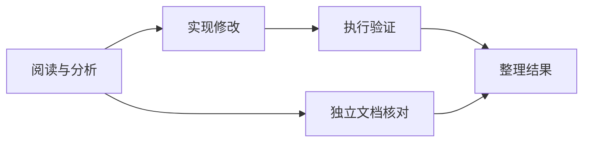

# 多 Agent 的先后顺序，交给 DAG：先拿到证据，再执行下一步

> “先阅读源码，再修改，再验证”是一条执行依赖。把它写进提示词有帮助，但真正保证第二步不会提前开始，需要调度系统理解这条依赖。

这是 [Cognitive OS](https://github.com/LeonQin-ai/cognitive-os-agent) 技术系列第 3 篇。上一篇的群聊适合讨论问题；这一篇关注有交付结果的多角色工作流。

## 角色分工和执行依赖是两件事

“分析师、开发者、验证者”定义了谁做什么，却没有自动规定什么时候可以做。假如分析师还在读取文件，开发者已经开始修改，工作流即使最终给出漂亮总结，也可能建立在不完整的输入上。

项目把这类关系编译为 DAG：节点描述角色和任务，边描述上游到下游的依赖。验证通过后，Runtime 按拓扑层执行，同层独立节点可以并行，后续层等待前驱结果。



层式执行比较直观，也有代价：某层中较慢的独立节点可能延后下一层。当前实现选择了清晰的依赖边界，并不宣称已经采用全局最优的动态调度。

## 引用结果，也是在声明依赖

一个可提交到 `POST /v1/flows` 的结构示意是：

```json
{
  "nodes": [
    {"id": "read", "agent": "reader", "task": "阅读指定源码，给出实际证据"},
    {"id": "review", "agent": "reviewer", "task": "基于 {{read}} 评审方案"}
  ],
  "edges": []
}
```

角色需要事先注册。这里即使没有显式写边，`{{read}}` 也意味着 review 依赖 read。否则一个节点可能在引用内容尚不存在时就启动。

校验还包括节点 ID 唯一、引用目标存在、禁止自引用和循环依赖。循环检测使用 Kahn 算法。错误结构应在执行前被拒绝，而不是让一组角色等待一个永远不会产生的结果。

## 上游失败后，下游应该是什么状态

如果 read 失败，review 没有执行条件。合适的状态是 `blocked`，而不是把它伪装成完成，也不是让模型自行猜测上游原本想输出什么。

当前节点进度区分 `queued`、`running`、`ok`、`error`、`blocked`。失败依赖会阻断后代节点；没有依赖关系的分支仍可完成。整体任务保留部分结果，并如实报告失败。

这样，用户可以看清“某一步执行失败”和“某一步因此没有执行”的区别。这对恢复、排错和面试讲解都很有价值：错误传播被写成系统行为，不依赖最后一段总结是否足够诚实。

## 讨论上下文不应变成新指令

还有一类细节容易让多 Agent 工作流误报失败。上游结果可能包含“已创建文件”“写入方案”等文本；下游只负责总结，却因为这些词被误判为自己也必须写文件。

项目将节点自己的用户任务与上游上下文分开，用当前节点的要求判断完成条件。证据用来帮助推理，不能悄悄扩大下游的执行职责。

这与群聊中把原始用户目标单独保留的思路一致：角色能读到更多信息，但信息来源和指令范围必须清楚。

## 测试依赖，关键是观察中间态

只检查最终文件存在，无法证明执行顺序正确。HTTP 回归会阻塞第一步的模型响应，在它尚未释放时查询节点状态，确认第二步仍为 queued、没有调用其模型、也没有生成目标文件。之后释放上游，检查下游开始时间不早于前驱结束时间。

另一组用例故意让上游失败，确认其子孙 blocked，而独立分支正常完成。这些都是可重复的控制流测试，使用本地 fixture，不需要付费模型。

源码：[Flow 编译与执行](https://github.com/LeonQin-ai/cognitive-os-agent/blob/main/backend/src/runtime/flow.c)、[接口定义](https://github.com/LeonQin-ai/cognitive-os-agent/blob/main/backend/include/runtime/flow.h)。验证：[依赖端到端测试](https://github.com/LeonQin-ai/cognitive-os-agent/blob/main/backend/tests/test_flow_dependencies_e2e.py)。

上一篇：[多轮讨论](02-agent-group-discussion.md)；下一篇：[Memory 与 Context](04-memory-and-context.md)。欢迎用一个包含失败分支的真实任务，检验这套依赖模型是否满足你的工作流。
