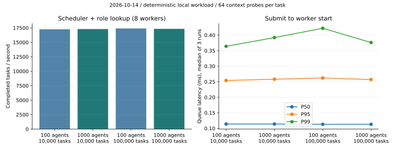
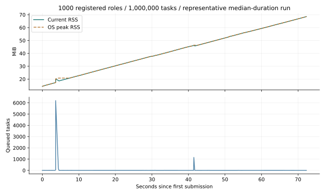
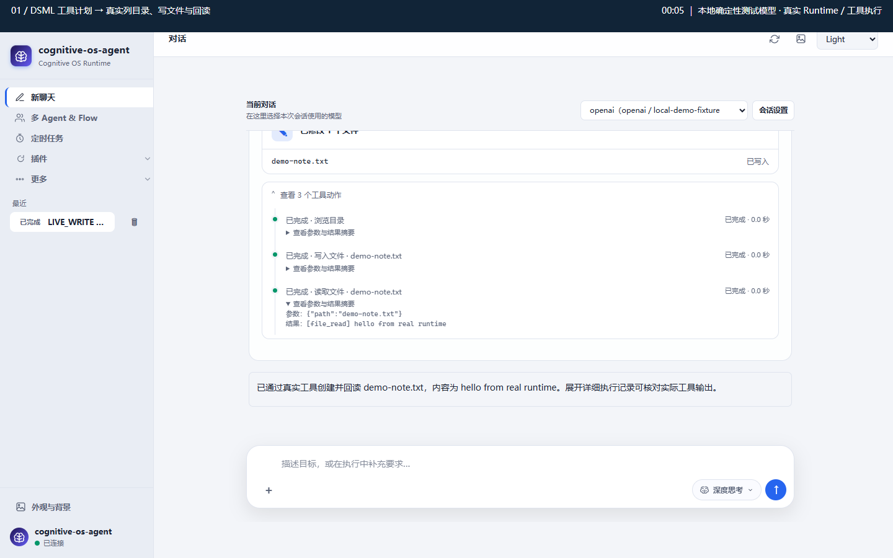

# Runtime扩展基准报告（2026-10-14）

## 方法与范围

完整规模4个组合，每组3个独立进程；固定8工作线程、64次Context探测/任务、8MiB聚合缓冲；Context另做650MiB和1GiB两组，真实MMU分配HOT、驱逐、概览、重新物化与磁盘hash核对。实际Runtime崩溃测试强制终止拥有的临时进程，重新启动相同状态目录。所有临时目录由TemporaryDirectory清理，没有使用用户正在运行的Runtime或实际SSH环境。

这些是确定性本地负载。Context预算的token为字符长度/4估算，不能替代Provider token账本；L1确定性概览有损，不是无损压缩。Source/cache/序列化/操作系统RSS分开记录。崩溃测试是进程级，恢复后显式重放幂等文件覆盖，不证明任意外部命令exactly-once或机器断电耐久性。

## 最终数据

### Results

Measured on Windows 11 (build 26200), Intel Family 6 Model 142, about 8 GiB RAM,
Zig cc 0.14.1 `-O1`. These are actual Scheduler/AgentPool/MMU/file-recovery runs
with deterministic local workloads; they exclude production model inference.
Registered roles are not concurrent processes. The scale workload uses 8 workers,
64 context probes per task and 8 MiB aggregate context; 2 auxiliary Runtime workers
remain idle. Scale values are medians of 3 runs; peak RSS is the maximum of those runs.

| Registered roles | Completed tasks | Elapsed ms | Tasks/s | Queue P50 / P95 / P99 ms | Peak RSS MiB |
| --- | --- | --- | --- | --- | --- |
| 100 | 10,000 | 579.370 | 17,260 | 0.114 / 0.254 / 0.364 | 16.95 |
| 1,000 | 10,000 | 578.199 | 17,295 | 0.114 / 0.258 / 0.392 | 17.09 |
| 100 | 100,000 | 5748.495 | 17,396 | 0.113 / 0.262 / 0.422 | 22.48 |
| 1,000 | 100,000 | 5771.132 | 17,328 | 0.113 / 0.257 / 0.376 | 22.57 |
| 100 | 1,000,000 | 65971.943 | 15,158 | 0.131 / 0.313 / 2.039 | 78.65 |
| 1,000 | 1,000,000 | 72279.054 | 13,835 | 0.144 / 0.346 / 14.790 | 77.92 |

All submitted tasks were admitted and completed, with zero failures/rejections;
ending active/queued counts were zero. Completed history was bounded to 64 records.
RSS samples include the retained benchmark verification arrays, not just task history.





A separate **backlog gate** held workers until 100,000 tasks had been submitted:
**99,992 queued**, 39.942 s until drained,
59.07 MiB peak RSS. Its queue delay includes the intentional
hold and is reported separately from ordinary throughput runs.

**Context pressure — one run per layout.** Three canonical records were made HOT,
evicted, reduced to WARM overviews, rehydrated to HOT, then reloaded from disk with
all original lengths and content hashes verified. L1 overviews are lossy; the
canonical store keeps complete content. RSS includes source records and serialization,
so MMU context budget is not a process-RAM limit. Source texts are generated ASCII
fixtures, not production conversation transcripts. No GiB prompt was sent to a model.

| Context layout MiB | Peak RSS MiB | Eviction recall ms | WARM cache bytes | HOT rehydrate ms | Canonical reload ms | Content checks |
| --- | --- | --- | --- | --- | --- | --- |
| 512 / 128 / 10 | 2860.61 | 306.725 | 3,900 | 7330.594 | 1144.853 | Passed |
| 768 / 128 / 128 | 3197.01 | 887.189 | 3,900 | 15020.763 | 2014.049 | Passed |

Per-operation counts and P50/P95/P99 are retained in JSON (bounded last-64 sample
windows; the large cases contain only 3 evictions each). These small samples do
not establish a tail-latency SLO.

**Crash recovery — one real process-termination run:** RUNNING task + available
snapshot → forced Runtime exit → INTERRUPTED detection → verified snapshot restore
→ explicit replay → DONE → successful subsequent task. Restart detection:
**511.031 ms**; snapshot restore: **18.285 ms**;
explicit replay to DONE: **54.946 ms**; crash to DONE:
**591.759 ms**. The killed boundary is the entire Runtime process
(`TerminateProcess` here, `SIGKILL` in POSIX tests), not an isolated in-process worker.
Replay covers idempotent file replacement; arbitrary external operations are not
replayed automatically and exactly-once/power-loss recovery are not claimed.

[Full benchmark report](runtime-benchmark-expanded.md) ·
[Whitepaper and 3 architecture diagrams](runtime-whitepaper.md) ·
[5-minute continuous live console recording](runtime-demo.mp4).

[](runtime-demo.mp4)

The original-speed, silent recording has Chinese captions and shows the real web
console, file tools, source paging, two-agent replies, a 100,000-task deterministic
Runtime workload, Context recovery and regression commands. The model is a local
deterministic fixture. [Video metadata, hash and captured tool evidence](runtime-demo-evidence.json).

| Time | Live operation |
|---|---|
| 00:00 | DSML batch, directory listing, file write and read-back |
| 00:30 | Read the current DSML source excerpt in contiguous pages |
| 01:15 | Register two agents and receive both replies in a real group |
| 02:05 | Run 1000-agent / 100,000-task Runtime benchmark |
| 02:50 | Run 4 MiB Context eviction and canonical-content recovery |
| 03:35 | Run planner, group persistence and hard-crash recovery tests |
| 04:20 | Exact file edit, read-back, task journal and trace history |

Re-record on Windows after building the CLI, unit tests and Runtime benchmark,
from `backend` in PowerShell (requires Playwright, Edge and Python imageio-ffmpeg):
`$env:NODE_PATH=(Resolve-Path webarena/node_modules).Path; node tools/record_live_demo.cjs`.
The default take records 300 seconds continuously;
`--smoke` checks the same flow at a smaller load and is not the delivered video.

Reproduce after building `runtime-bench` / `bench-runtime`:

```bash
cd backend
python tests/run_runtime_measurements.py --full --output docs
python tests/run_runtime_measurements.py --million --compiler "Zig 0.14.1 cc -std=c11 -O1 -g" --output docs
python tests/test_runtime_benchmark.py          # scale + MMU + backlog correctness smoke
python tests/test_crash_recovery_e2e.py --report # owned process kill, restore, explicit replay
```

Raw measurements: [scale](runtime-scale-2026-10-14.json),
[million-task extension](runtime-million-2026-10-14.json),
[backlog](runtime-backlog-2026-10-14.json),
[Context](runtime-context-pressure-2026-10-14.json),
[crash recovery](runtime-crash-recovery-2026-10-14.json).
The previous [128 MiB baseline](runtime-benchmark.md) used a different
per-task memory probe scheme and is retained as history, not a direct scaling comparator.


## 统计口径与限制

- 排队：提交前单调时钟→Worker开始，原始微秒记录后换算ms；各run内部P50/P95/P99，表格对3个run取中位数；峰值RSS取最大run。没有计算跨run混合样本分位数。
- 队列/内存曲线：每2048次提交及最后一次采样，所以observed_queue_max是观察值；单独backlog gate用例在放行前实际保留99992队列任务。
- start_rss：分配Context后、提交前；end_rss：DAG与回滚后、验证数组/Context释放前。OS峰值包括整个子进程，retained_bytes是scheduler估算，不能相互替代。
- MMU事件延迟按单调微秒计时；P50/P95/P99是最近最多64个事件的nearest-rank。三个驱逐事件的P95/P99通常都等于最大值，样本数随数据保留；端到端recall延迟另包含排序/处理/返回JSON。
- rehydration事件计数测的是被驱逐页重新生成L1；HOT重新物化的完整阶段耗时使用rehydrate_recall_ms。规范磁盘重载单独测canonical_reload_ms，之后核对所有原始内容。
- 崩溃检测计时从重新启动到API看到INTERRUPTED，不是后台监控独立Worker的检测SLO；crash_to_done包含重启、API轮询、恢复和显式重放。
- 百万任务新增独立结果：100/1000 Agent各3轮，每轮实际提交并完成1,000,000任务，共6,000,000；失败、拒绝、结束活动/队列均为0，完成历史不超过64条，事务回滚核对通过。没有测百万任务全部同时积压；上面的backlog是独立10万积压案例。
- 百万任务耗时：100 Agent为58.743/65.972/74.076秒，1000 Agent为73.305/71.629/72.279秒。1000 Agent的中位吞吐较既有10万任务基准约下降20%，排队P99为14.790 ms；采样队列峰值6201。长运行期间的突发排队不能以平均吞吐掩盖，没有声称线性扩展或预设性能SLO。
- 图表纳入百万任务结果；内存/队列图采用1000 Agent百万任务的耗时中位轮次。RSS增长包含基准验证数组逐页实际写入，不能据此断言Runtime任务历史泄漏。百万案例Native代码基于cdff91a，工作负载及编译参数与原规模组一致；不同轮次系统负载会影响尾延迟。

## 代码与用例

#129修复未计费L2/COLD缓存；#130补RUNNING日志、启动INTERRUPTED识别和单调任务ID，修复ID0恢复，历史UI只显示最新终态/中断。#122提供基准扩展、指标、图表、白皮书与录像。Native回归、规模/MMU/backlog smoke、实际进程崩溃与UI用例进入CI。

绘图：安装matplotlib后执行`python tools/plot_runtime_benchmarks.py`；SVG为最终图，build目录PNG仅供视觉检查。真实录屏使用`node tools/record_live_demo.cjs`，连续原速展示应用交互和实际工具输出；本地fixture模型与真实Runtime执行范围在画面中明确标注，时长和分辨率经浏览器解码验证。

大内存用例会实际分配多个GiB，包括规范正文缓存、活动表示和JSON序列化；应在明确可承受该负载的测试主机上执行。CI只运行4MiB压力用例，不把CI smoke标为已复测1GiB。
