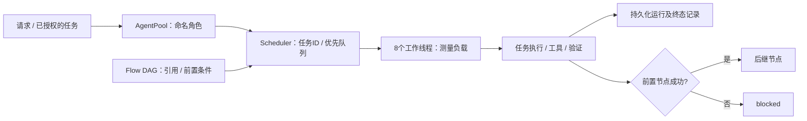
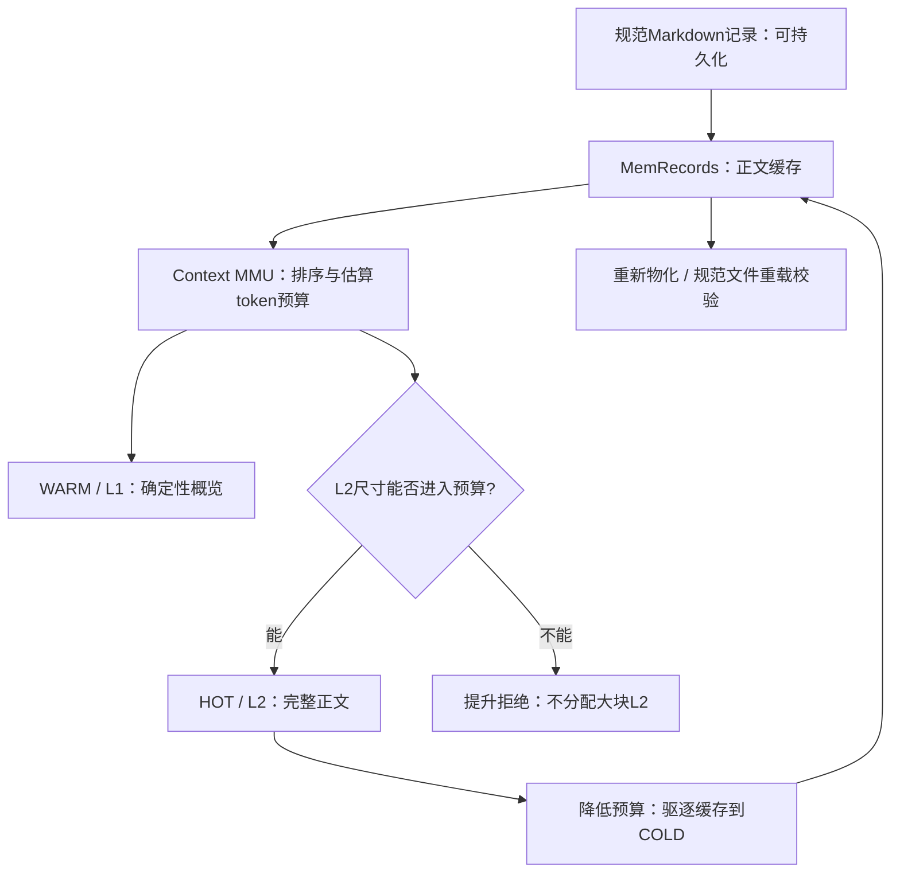
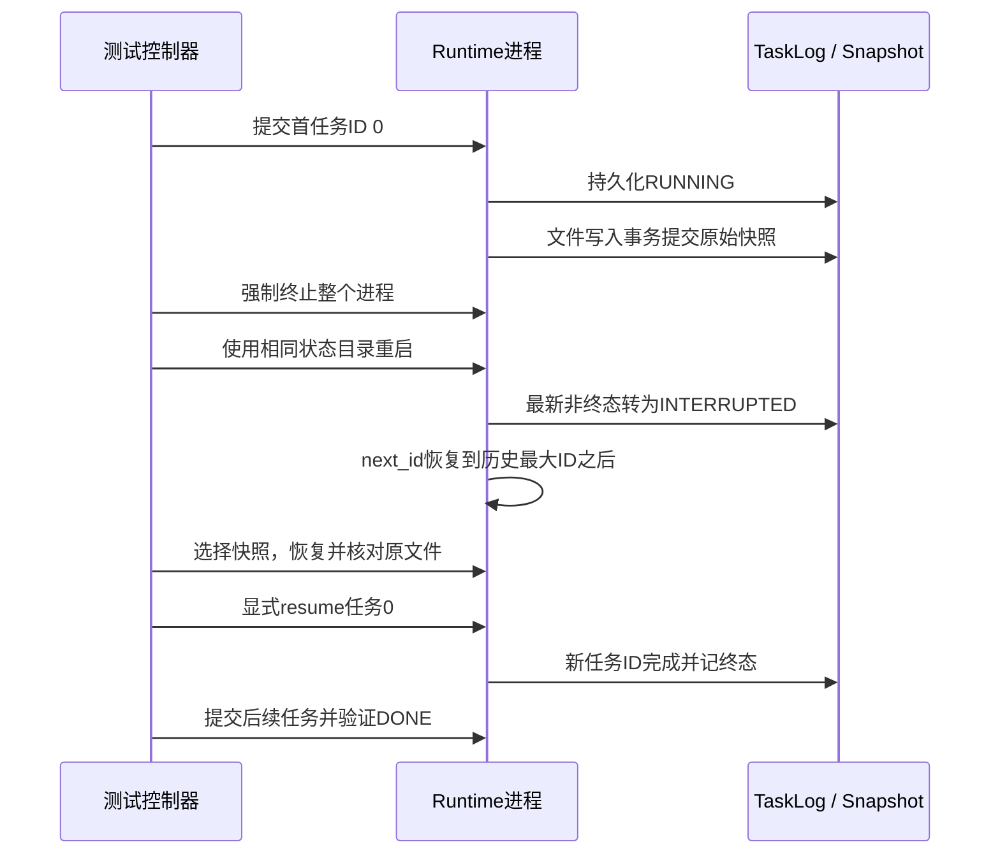

# Cognitive OS Runtime：边界、状态与可验证性能

版本：2026-10-14；对应 #122 的扩展基准和 #129/#130 的修复。

## 1. 领域与聚合

| 领域 | 聚合 / 状态所有者 | 边界 |
| --- | --- | --- |
| 调度 | Scheduler拥有任务ID、队列、Worker与历史记录；Task拥有输入、取消/超时和进度锁 | Agent数量是注册角色数；Worker才是线程执行容量 |
| 协作 | AgentPool维护名称/角色；Flow拥有DAG、依赖与节点结果 | 引用建立依赖，上游失败阻断后继，独立分支可以继续 |
| Context | MemRecord保存规范正文；Context MMU拥有L0/L1/L2缓存与HOT/WARM/COLD状态 | 记录存储与活动模型上下文是不同内存层；token_budget是估算字符预算 |
| 事务 | Snapshot拥有原始文件的内容块和manifest；Tx拥有本轮工具执行与提交/回滚 | 事务保护文件；不能把外部服务或非幂等Shell自动视为可回滚 |
| 持久化 | TaskLog拥有生命周期转换与恢复输入；FlowStore保存协作状态 | 内存调度器状态与持久化日志状态分离 |

## 2. 调度与协作图

基准使用真实Scheduler和AgentPool。注册1000个角色，不意味着1000个并发进程；测量负载是固定64次Context探测、角色指令拼接和任务完成，工作线程8个。辅助Runtime另外拥有8个空闲调度Worker。DAG测量使用离线mock模型，所有指标不包含生产模型推理或网络成本。

## 3. Context内存模型

L1是截取正文并补充属性的**有损概览**，不是无损编码。完整内容必须从规范记录恢复。记录正文仍可占用大量RAM；MMU的活动预算不等于整个进程RSS上限。压力基准分别记录source_bytes、materialized_bytes、token_used和OS峰值工作集，不混淆这些指标。

压力序列：650MiB（512/128/10）和1GiB（768/128/128）规范记录→足够预算使3页HOT→降预算为1以驱逐→4096预算生成WARM概览→恢复高预算重新物化HOT→释放并从磁盘重载所有规范记录，核对每条正文长度和内容hash。测试没有把这些GiB正文发给模型。

## 4. 崩溃恢复图

Worker是进程内线程，不能隔离地对“Worker-3”发送SIGKILL。验证边界是整个Runtime子进程；Windows使用TerminateProcess，POSIX使用SIGKILL。没有伪称独立Worker进程恢复。

恢复不会自动重放外部操作。测试先恢复快照，再由控制器显式resume，重放的是幂等文件覆盖，并验证没有重复fixture写入。它不证明任意Shell/外部服务操作的exactly-once，也不证明机器断电后的磁盘耐久性。日志超过现有32MiB解析上限时启动恢复明确失败，不能悄悄从0复用ID。

## 5. 观测与验收

- 调度：提交/接收/完成/失败/拒绝守恒；结束活动/队列归零；P50/P95/P99/最大排队延迟；固定Worker和负载下对比100/1000角色与1万/10万Task。
- 内存：按提交阶段采样当前RSS、峰值RSS、队列、历史估算字节；历史上限64条/1MiB。
- Context：真实HOT分配、驱逐字节/次数/耗时、L1概览字节/耗时、重新物化、规范内容磁盘恢复校验。
- 崩溃：运行中任务及可用快照前置证据、故障边界、启动检测、恢复、显式重放、后续任务，逐阶段测时。
- 完整性通过是正确性验收；吞吐和延迟是当前机器观测，尚未承诺性能SLO。

## 6. 复现与原始数据

`tests/run_runtime_measurements.py --full --output docs`运行完整规模/压力案例，`tests/test_runtime_benchmark.py`运行小规模CI正确性测试。`tests/test_crash_recovery_e2e.py --report`构造真实子进程崩溃并输出数据。Windows先执行`build.ps1 -Target all`，POSIX使用Make，macOS也支持CMake/CTest。

最终指标与环境见README Runtime benchmark和[扩展报告](runtime-benchmark-expanded.md)，原始JSON及绘图脚本随报告保留。三次规模实跑用于报告中位数和范围；单次大内存压力/崩溃测量标明样本量，不把一个样本包装为P99分布。
