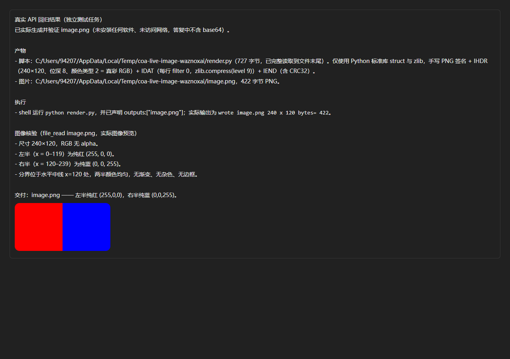
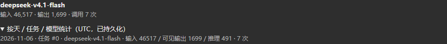
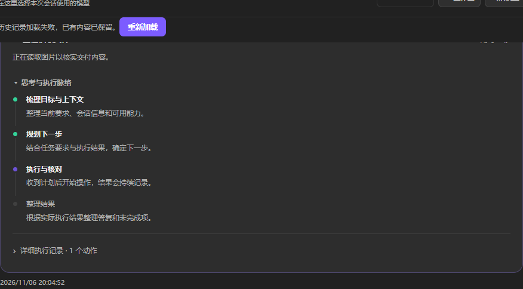

# Issue validation: 254–256

Code baseline: 07d1d27, plus reply overflow fix in the accompanying commit.

- #254: real configured deepseek-v4.1-flash generated and read back a 240×120 PNG. Byte/pixel validation, desktop/mobile display, zoom and redraw passed. Screenshot replays that actual task/PNG in the current reply renderer. The reply now has no nested maximum height, so its image is not clipped.
- #255: the screenshot uses the same real provider usage: prompt 46,517, visible completion 1,699, reasoning 491, seven requests. Day boundaries use UTC. REST regression verifies distinct task groups, total consistency and persistence across restart. Historical unrecorded usage cannot be reconstructed.
- #256: native HTTP fixture verifies the public assistant status is present in the durable Runtime trace. Screenshot is explicitly a UI regression scenario using that verified public status text; it is not a screenshot of a live paid task. Hidden reasoning is not exposed. Original-task session contamination has not been replayed and remains a separate unresolved part of the report.

