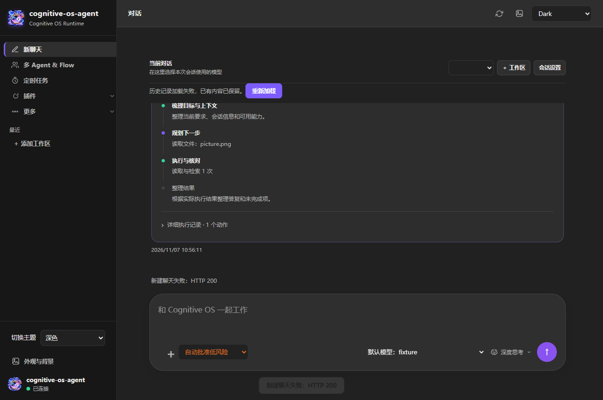
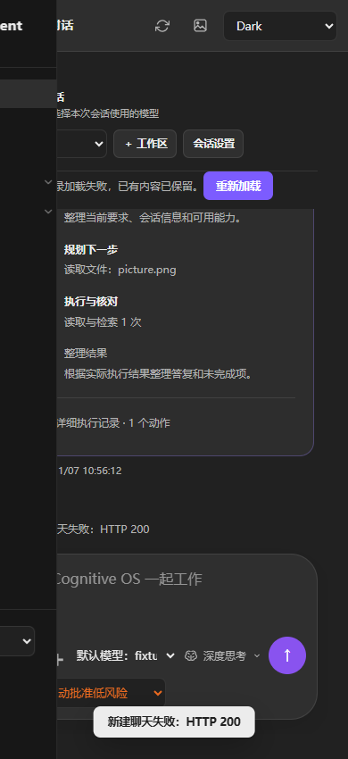

# Session memory and progress regression

## Fixes

- Load `chat/<session>.jsonl` at task entry, before building the model context; opening the history UI is no longer required after restart.
- Keep V3 session-private learning and recall enabled when shared memory is disabled. Private-only recall excludes global/shared scopes; the legacy fallback also respects the sharing switch.
- Preserve public stage commentary in a gray log during execution and alongside the completed answer. This displays public updates, not private reasoning or token-by-token streaming.
- Synchronize the timestamp browser fixture with initial history loading to remove a Windows CI race.

Canonical long-term records are Markdown at `state/memory/records/mem_<id>.md`, with `scope=session/<id>` metadata. Chat transcripts remain JSONL; they serve a different purpose from long-term memory records.

## Results

- `memory-isolation-test.exe --memory-v3-runtime`: 10,251 passed, 0 failed, including restart without history API, private-only recall, long session IDs, and 100 private scopes cross-checked against all other scopes.
- `node tests/test_generated_image_ui.cjs`: passed at 1280 and 390 px, including stage logs during execution and after completion, image delivery, redraw, zoom and spoof rejection.
- `node tests/test_chat_timestamps_ui.cjs`: passed.
- Paid `tests/test_live_memory_ab.py --trials 1`: deepseek-v4.1-flash, fresh processes with the transcript removed and identical durable seed state. Seed produced one Markdown record (38,458 input / 1,418 output tokens). Legacy recall: 1/1, 5,855 input / 85 output. MMU: 1/1, 5,901 input / 206 output. No model failures; total 51,923 tokens. Monetary cost unavailable from this endpoint. This small run proves recall after restart, not a statistically meaningful benefit or token saving.

Screenshots use controlled browser fixtures, not a paid-task screenshot:

Remote CI and original long-task reproduction are separate acceptance gates; local results do not imply that all reported long-task symptoms are resolved.
